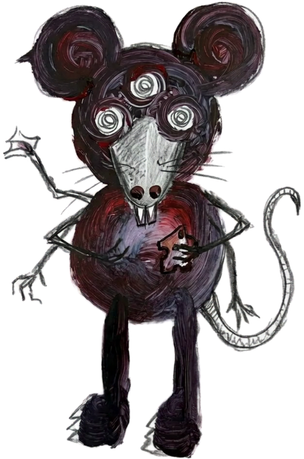

# Monster Shadow Theatre

Four drawn monsters that behave like **shadow puppets on strings**, hanging in front of
your webcam image. The camera turns the room into a lit screen; the monsters are dark
silhouettes you can pick up, fling, resize and spin.



## Run it

No build step, no dependencies — it is plain HTML, CSS and ES modules.

```bash
npm start                     # python3 -m http.server 8000 --bind 0.0.0.0
# or
python3 -m http.server 8000
```

Then open <http://localhost:8000>.

> The camera needs a secure context: `localhost` works, and any HTTPS host works.
> Serving over plain HTTP from another machine will block `getUserMedia`.

## What you can do

| Gesture | Result |
| --- | --- |
| Drag with mouse / finger | Move a monster — it lags and swings behind your hand |
| Fling and let go | Momentum is thrown into the string, so it wobbles and settles |
| Scroll / trackpad | Resize the monster under the cursor |
| Double-tap / double-click | Spin it on its strings |
| **Hands** button | Turn on webcam hand tracking; pinch near a monster to grab it |
| **Shadow / Spirit** | Switch between black silhouettes and the painted artwork |
| **Reset** | Send every monster back to its mark |
| Keys | `C` camera · `H` hands · `S` shadow/spirit · `M` sound · `R` reset · `Esc` dismiss intro |

## How the puppet feel works

Each monster has two points: a **grip** (where your hand holds it) and a **body** that
chases the grip through a damped spring. The body therefore trails the grip, and that
trail is converted into tilt around the grip, so the creature hangs, swings and settles
like paper on strings. A small idle sway keeps the stage alive when nobody is holding
anything.

Grabbing uses per-pixel alpha testing (an offscreen mask per image), so you only pick a
monster up when you actually touch the drawing, not its transparent bounding box.

## Files

```
index.html        stage, HUD, intro
css/style.css     lamp, grain, vignette, puppet layers, UI
js/main.js        loop, input, hand ↔ puppet binding, UI wiring
js/puppet.js      spring physics, render transform, alpha hit-test
js/camera.js      webcam + optional MediaPipe HandLandmarker
js/audio.js       tiny synthesised grab / pluck / spin sounds
assets/           the four drawings
```

Hand tracking is optional and loaded on demand from a CDN (MediaPipe Tasks Vision); it
needs an internet connection the first time and falls back to mouse/touch dragging if it
cannot load. Video frames never leave the browser — they are only painted on this page.
